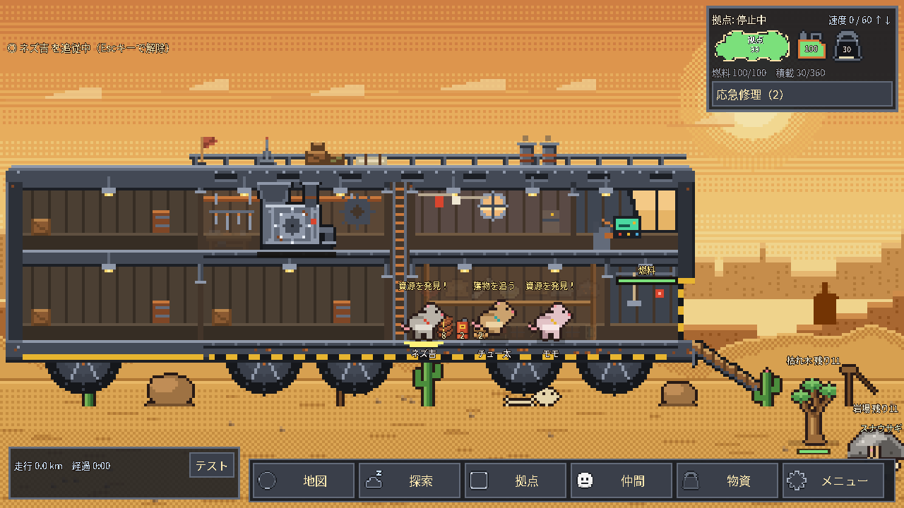
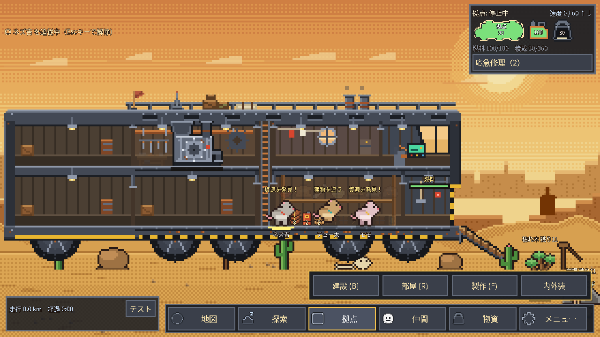

# 下部操作バー（2026-10-13 実装）

右上は拠点HP・燃料・積載・移動状態・応急修理、操作入口は画面下部へ集約しました。画像はGodot 4.6.3 / 1280×720の実行画面です。

| 入口 | 操作 |
|---|---|
| 地図 | 行先選択（M） |
| 探索 | 採取地点（G）、遠征（X） |
| 拠点 | 建設（B）、部屋（R）、製作（F）、内外装（O/I） |
| 仲間 | 仲間の管理（C） |
| 物資 | 資源一覧・累計、倉庫（Tab）、製作（F） |
| メニュー | 運営の方針（P）、保存・続きから |

展開メニューは同じ入口・Esc・外側クリックで閉じます。内外装の「戻る」は拠点メニューへ戻ります。各画面を開くとバーは隠れ、画面を閉じると戻ります。危険通知と既存ショートカットは維持しています。

検証：集約37対象のうち初回35成功、旧入口参照の地図/保存テストを新配置へ追従した再検証5/5成功。実行コードは同一。関連9/9、描画あり操作、拠点HUD・仲間HUDも成功。失敗履歴と証跡はCLAUDE.md末尾参照。スマホ実機・Windows・OS入力・音声は未検証、PC同期も未確認です。

承認見本のLibrary取得と実画像のLibrary保存は接続エラーでできなかったため、指定された配置仕様に沿って実装し、画像はこのGitHub資料で共有しています。生成見本の絵をゲームへ取り込んではいません。
