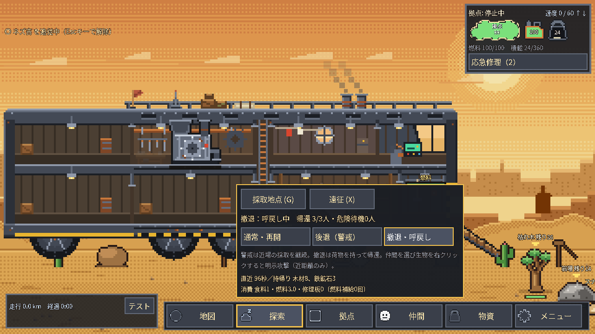
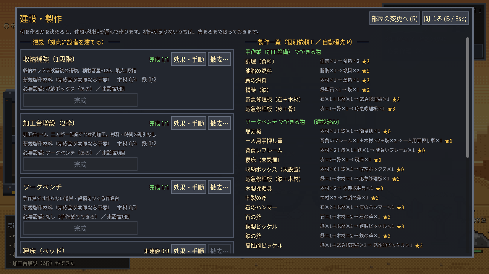
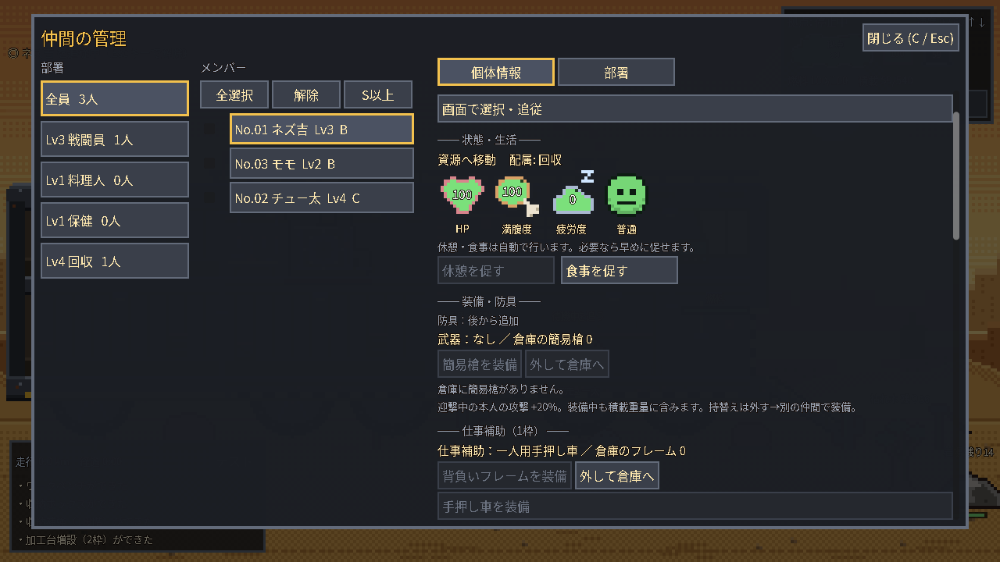
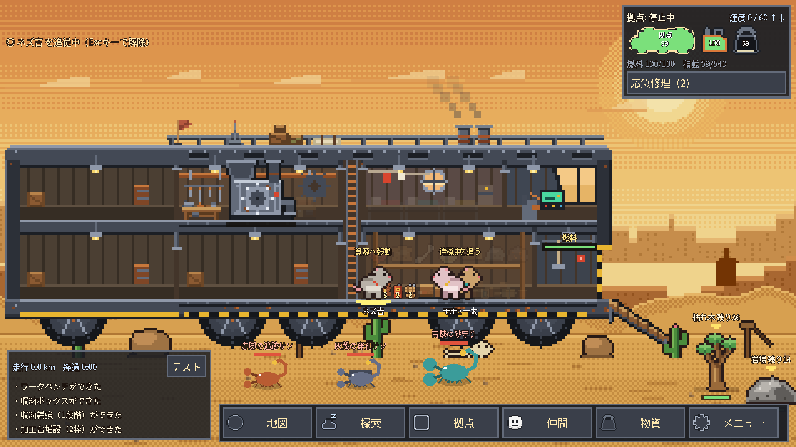

# 第1循環と屋外判断の実装・検証（2026-10-14）

## 作業の基準と差分保護

作業先は既存 `/workspace/desert_rats` の main、開始HEADは `0000b9110c82944ea674a82c70e8b765811fd559`。初期リポジトリ `/workspace/-` は変更していない。別の開発ブランチ・チェックアウトは作らず、reset/clean/強制pushは使っていない。

再開時の既存差分27ファイルと未追跡12ファイルを `/workspace/night-evidence/preserved-20261014T185535Z/` にtarとbinary patchで保全した。変更日時から作者を推定せず、差分を機能別に調べ、以前の検証snapshotに記録された39ファイルのSHA256とも照合した。収納・手押し車・2枠加工、屋外方針・生物・成果、保存・UI・検査の範囲と一致し、無関係な競合変更は認めなかったため、既存資産として引き継いで修正・検証した。

## 実装と暫定値

| 項目 | 操作・効果 | 暫定費用・数値 |
|---|---|---|
| 収納補強 | Bで収納ボックス設置後に建設、最大1段階 | 木4・鉄2、8秒、容量+120。基本360＋箱60＋補強120＝540 |
| 一人用手押し車 | Fで製作しCの仕事補助枠へ装備。フレームは先に解除し製作素材として運ぶ | フレーム1・木2・鉄2、6秒。1便8個、重量35は装備中も計上 |
| 加工台増設 | Bで作業台設置後に建設。2人が各1枠を担当 | 木4・鉄2、8秒、1→2枠、最大1増設 |
| 後退（警戒） | 探索メニュー。新規の採取・狩猟は斜路足元から近場に限定 | 距離240。車体の位置を後退させる操作ではない |
| 撤退・呼戻し | 荷物を保持して帰還・荷卸し、帰還人数を表示 | 既存の帰還経路を使用、屋内作業は継続 |
| 危険感知 | 近くの敵を感知した本人が帰還・待機 | 視認距離180、再試行待ち15秒。HP75以上で通常・再開を選ぶと危険待機を解除 |
| 初期の村 | 木・石・少量鉄で基本鉄道具を準備 | 初回木36、石10～14、鉄鉱石4。新規生成時だけ適用 |
| 大鉱山 | 既存の有限鉱床と危険生物 | 鉱床84を維持、危険を目視して撤退判断 |

手押し車は個人用で採取速度・拠点容量を増やさない。加工は注文・材料置場を共有し、担当者・投入材料・進捗・出力は枠ごとに独立する。時間や燃料の割引はなく、満杯時も完成品を所有重量に含める。加工中の取消・増設台撤去では進捗や出力を捨てない。

既存の採取速度倍率（素手/木/石/鉄の基準1/2/3/4）と道具の適性、材料1から主素材1の会計は維持。今回、道具耐久や新しい希少素材は追加していない。

### ①帰還、②採取場所、③成果、④生物

- 呼戻しは採取途中の残量・端数・取得済み袋を保持し、全員の帰還と荷卸しを数える。危険帰還後は待機が持続し、時間経過だけで同じ敵へ再出撃しない。通常・再開はHP75以上の本人を解除する。従来の軽傷時の生活基準は変更しない。
- 村と鉱山の資源差は既存地域上で表現する。往復・保存復元で資源を補充しない。通常地図では時間抽選の襲撃と資源・生物補充の好機を発生させず、地域台帳の有限枠を使用する。保存済みの旧イベントは維持する。
- 探索メニューに直近の往復秒数、実際の外部持帰り品、食料消費個数、タンク燃料消費量、修理資材消費個数、補給回数を短く表示する。倉庫間運搬と加工出力は外部取得に数えない。全員が車内で荷卸しを完了すると往復結果が確定する。
- 赤脚の追跡サソリは屋外の仲間だけを攻撃する。灰殻の穿孔サソリは仲間を追い、車体へも攻撃する。青鋏の砂守りは中立で、本人から攻撃された時に反撃する。自動迎撃は無抵抗の中立を選ばない。仲間を選択し、近くの生物を右クリックすると明示攻撃を要求できる。
- 生物の視界200、縄張り340（穿孔種600）、見失い4秒＋探索5秒、その後8秒の猶予を暫定値とする。車内の仲間だけを理由に追跡を無期限延長しない。
- 砂原は中立1個体、鉱山は3性質各1個体の固定枠。120秒ごとに生存個体の滞在有無と位置±35を変える。接近中・追跡中の個体はその場で切り替えず、死んだ個体を復活させない。同時刻の出入りでは再抽選しない。敵位置のレーダーや自動警報は追加しない。

## 検証の区別

`test_first_cycle_flow.gd` は新規3人・通常物資・有限の地域資源を使い、素材/道具/設備を注入しない。作業台、木→石→基本鉄道具2種、フレーム、箱、収納補強、手押し車、加工台増設、鉱山の近場採取、手動呼戻し、奥の危険感知、3人と荷物の帰還まで進める。方針・速度・製作依頼・運搬依頼は既存APIで操作する。25ゲーム秒ごとに保存復元を照合する。

core内の`loop_vanilla`（32分×2）と`loop_normal`（28分×2）は`legacy-world-test`を明示した既存ループ互換fixtureで、食事・補給・修理の継続を検査する。有限な地域マップで同時間放置して生存することの保証ではない。

`test_first_cycle.gd` は境界条件のfixture。2枠同時担当・燃料/重量・中断保存・出力待ち保存・取消・撤去拒否、運搬便数、同材料同能力の加工比較を実AIで検査する。素材を配置するfixtureを通常取得の成功と混同しない。

`test_field_operations.gd` は帰還途中の袋と進捗、危険待機、各生物の攻撃対象、見失い、旧v3追加項目省略、破損した成果値の拒否を検査。`test_ecosystem.gd` は有限資源・個体ID・時間変化・死亡維持・保存を検査。`test_field_ui.gd` はViewport入力で警戒/呼戻し/再開/装備ボタンを操作し、画像出力時のみ描画フレームを待つ。

### 検査で見つけた問題と対応

追加の右クリック入力検査では、対象判定がOSの現在マウス位置を参照し、Viewportへ渡したクリック位置とずれる点を確認。右クリック判定にイベントの画面座標をカメラ変換して使用するよう修正し、中立への明示攻撃要求と呼戻し中の拒否を同じUI検査へ追加した。

初回coreは38/43成功。品目分類順、危険判定が従来の軽傷生活行動まで止める問題、2枠目に完成品だけが残ると作業者が座標原点へ向かう問題を修正し、それぞれの回帰を確認した。保存復元が渡されたsnapshotを変更する不要な処理も除去し、不正な成果値の拒否と入力不変を追加検証した。

旧道具進行は準備前に危険な鉱山へ向かって失敗していたため、基本鉄2種を村で準備する手順に変更した。木製/石製の斧も通常製作する条件と保存復元を維持し、鉱山の実採取はworld_flowとfirst_cycle_flowで継続検査する。

旧撤去進行は獲物を狩る前に地域を切り替えて皮が1個不足した。都市で皮を回収してから未走行の都市→村の街道を速度60設定で進み、残るコブ獣から材料を得る経路へ変更した。4設備の建設・撤去・保存復元・再設置各2回、近場12採取は維持し、素材を配らずに成功した。

UI検査追加後の最初のcore実行はimportが新しいUIDを生成し、開始前後のソース同一条件を満たさなくなったため途中終了した。ログは削除せず、UID生成済みの固定状態でcoreを再実行する。

## 制限と未検証

- Linux Godot 4.6.3で検査。Windows/Godot 4.7.2、OSそのもののマウス入力、音声は未検証。UIは実Viewport入力とXorg/llvmpipe描画で確認する。
- 検証seed以外の全生成・長時間放置生存・全ての資源配分を保証しない。初期の自動製作任せで木や鉄を使い切らず、鉄道具用に木4を確保し不要な自動製作を止める判断が必要。
- 既に生成済みの旧セーブの村には木・鉄や生物を追加しない。旧セーブの材料不足を無断補填しない。固定個体を全て倒した場合は再生しない。
- 食事・補給・修理の既存ループは維持。新しい中継サービス、遠隔自動防衛、ボス、テイム、大規模地図は今回追加しない。

## 再実行

```bash
python3 tools/run_checks.py --suite core --output-dir /tmp/desert-night-checks
godot --headless --fixed-fps 60 --path . -s res://tools/test_first_cycle_flow.gd -- --diagnostic-seed=502
```

画像が必要な場合はグラフィックス環境から `tools/test_field_ui.gd -- --screenshots=<既存出力ディレクトリ>` を実行する。検査時のuser://は既存プレイの保存先と分離する。

## 比較結果と通常進行

| 条件 | 結果 |
|---|---|
| 木24の実運搬・通常3個/便 | 8便・65.4ゲーム秒 |
| 木24の実運搬・フレーム5個/便 | 5便・39.6ゲーム秒 |
| 木24の実運搬・手押し車8個/便 | 3便・22.4ゲーム秒 |
| 同材料20→食料40・1枠 | 133.8ゲーム秒 |
| 同材料20→食料40・2枠、別の2人 | 81.2ゲーム秒 |
| 新規通常進行seed501 | 992.4ゲーム秒で強化3種・危険から3人帰還・保存照合成功 |
| 同seed502 | 958.8ゲーム秒で同条件成功 |
| 同seed503 | 1105.0ゲーム秒で同条件成功 |

2枠は運搬と生活行動も含むため、所要時間が常に半分になる保証ではない。1人では同時2作業を行わない。経過秒数はゲーム内時間で、テスト実行の実時間とは異なる。

## 最終判定・証跡

Linux/Godot 4.6.3のcore **44/44成功**。その後の右クリック座標調整とUI検査追加に対して、関連 **7/7成功**（import、field_ui、navigation_bar、field_operations、save_game、first_cycle_flow、first_cycle）。各実行の開始前後でソース状態・SHA256が一致（source_changed_during_run=false）。最終コードのSHA256はfinal-click-checks/results.jsonに記録。core後に変えたコードはmainとそのミラーの右クリック座標、追加したUI検査だけで、長時間ループを再実行済みとは扱わない。新規通常進行501/502/503、専用境界検査、Viewport入力とグラフィックス画像を確認した。最後の関連検査の後は文書と証跡のみを追加した。

- [core結果・実行時ソースSHA256](night-evidence-2026-10-14/core-results.json)
- [右クリック調整後の関連7件・最終ソースSHA256](night-evidence-2026-10-14/final-click-checks/results.json)
- [通常進行501](night-evidence-2026-10-14/first_cycle_flow.log) / [502](night-evidence-2026-10-14/cycle-502-final.log) / [503](night-evidence-2026-10-14/cycle-503-final.log)
- [二枠・運搬比較](night-evidence-2026-10-14/first_cycle.log) / [警戒帰還・生物](night-evidence-2026-10-14/field_operations.log) / [有限個体群](night-evidence-2026-10-14/ecosystem.log)
- [設備撤去の通常進行](night-evidence-2026-10-14/packing_flow.log) / [描画付きUI入力](night-evidence-2026-10-14/field-ui-graphical-final.log)
- 初回失敗は[初回結果](night-evidence-2026-10-14/initial-core-results.json)と同ディレクトリのinitial-*.logに保持。UID生成による中断記録も保持し、未実行を成功に数えていない。

以下の画面はUI専用fixtureで設備・表示用の成果値を配置した画像。通常取得・進行の証拠は上記first_cycle_flowログを参照する。





